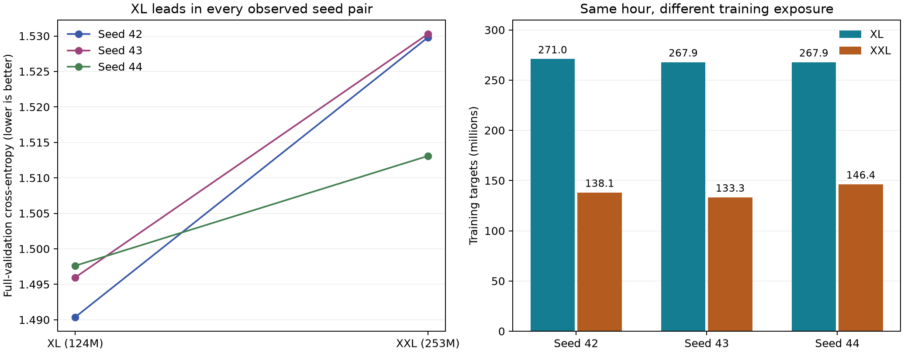
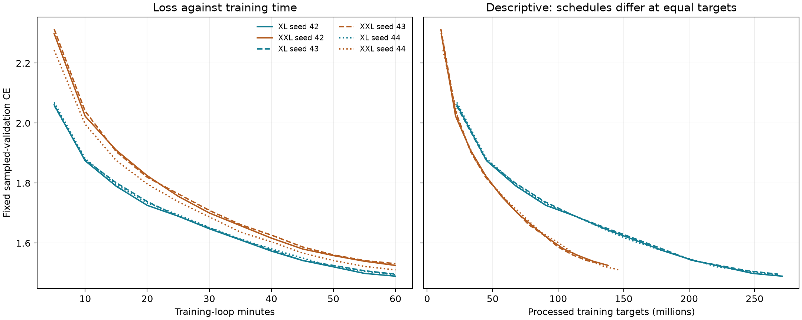

# One-hour follow-up analysis

Analysis of returned scores and logs; no models were trained or re-evaluated here.

**XL has lower reported full-validation loss than XXL in all three seed pairs, and every XL run beats every XXL run.** The mean CE advantage is 0.029731 nats/token, corresponding to 2.93% lower perplexity for XL. This strengthens the shared-recipe, one-hour observation. It does not establish intrinsic architectural superiority, convergence, or an optimized recipe for each size.

## Six-run results

| Seed | XL CE | XL PPL | XL targets (M) | XXL CE | XXL PPL | XXL targets (M) | XXL minus XL CE |
| --- | ---: | ---: | ---: | ---: | ---: | ---: | ---: |
| 42 | 1.490381 | 4.4388 | 271.016 | 1.529798 | 4.6172 | 138.121 | +0.039417 |
| 43 | 1.495970 | 4.4637 | 267.911 | 1.530280 | 4.6195 | 133.325 | +0.034309 |
| 44 | 1.497618 | 4.4710 | 267.891 | 1.513084 | 4.5407 | 146.387 | +0.015466 |

| Model | Mean CE | Sample SD | PPL from mean CE | Mean targets (M) | Mean targets/s | Cache equivalents |
| --- | ---: | ---: | ---: | ---: | ---: | ---: |
| XL | 1.494657 | 0.003793 | 4.4578 | 268.939 | 74,704 | 0.5674 |
| XXL | 1.524387 | 0.009792 | 4.5923 | 139.278 | 38,688 | 0.2938 |

PPL from mean CE is the geometric mean of per-run perplexities, not the arithmetic mean. All six score rows report 3,808,643 evaluated targets. This equals the validation cache length minus its first token, consistent with the planned full-stream protocol; count agreement alone does not verify target identity.

## What changed after common scoring?

| Archived model | Original sampled CE | Common full-validation CE | Change |
| --- | ---: | ---: | ---: |
| large_data100 | 1.546009 | 1.546940 | +0.000931 |
| xl_data50 | 1.502522 | 1.491074 | -0.011448 |
| xl_data100 | 1.506811 | 1.489276 | -0.017535 |
| xxl_data100 | 1.510593 | 1.523562 | +0.012968 |

The archived full-data XL–XXL gap is now 0.034285, rather than approximately 0.003782 under unequal sampled validation. Full-data XL also edges XL/50% by 0.001798, reversing their original sampled ranking. That tiny single-seed fraction difference does not establish a generally preferable data fraction.

## Training audit and stability

All **29,961 logged rows** have finite recorded losses and satisfy `targets = optimizer step × 4,096`. Steps and elapsed time are monotonic. Each run ends with exactly one final-evaluation row, which repeats the last completed update rather than adding another step. The six elapsed times range from 3,600.008 to 3,600.101 seconds. No divergence or unfinished time budget was found.

Saved configs agree on data/splits, preparation/evaluation seeds, optimizer, schedule, tokenizer, evaluation workload, and effective batch. Runtime hardware label, bfloat16 precision, code hashes/commit, cache hashes, Python/package/CUDA versions also match. Architecture, microbatch/accumulation, and experiment seed/name/output are the intended differences. Matching hardware labels do not prove identical live load or sustained performance.

XL processes 1.931 times as many targets in the hour. XXL seed 44 processes 5.98% more targets than seed 42 and 9.80% more than seed 43, while producing the best XXL score. Its improvement is compatible with an exposure contribution; these three runs cannot separate runtime effects from model/data randomness. Across-run SD is therefore observed run variability, not isolated initialization variance.

Every sampled-validation curve improves in its final five minutes. This supports further learning under the observed schedule but neither establishes convergence nor predicts eventual XXL overtaking.

## Does XXL learn better per target?

Existing curves suggest this is plausible. Linear interpolation of the saved sampled-validation observations at 120M targets gives:

| Model | Seed 42 CE | Seed 43 CE | Seed 44 CE |
| --- | ---: | ---: | ---: |
| XL | 1.6769 | 1.6777 | 1.6760 |
| XXL | 1.5506 | 1.5451 | 1.5489 |

These are descriptive interpolated sampled scores, not controlled equal-exposure results. At equal target counts the models are at different elapsed times and different warmup/cosine progress. Do not use the curves to claim exposure caused the one-hour ranking or reuse an old checkpoint as a matched step-schedule control.

## Strength and limits of the conclusion

Three independently seeded runs per family consistently favour XL here. There are six training runs, not millions of independent training replicates; all nine cross-family comparisons reuse the same six runs. A model-specific optimizer search was not performed. The result concerns these architectures and this recipe/allocation, not every larger or smaller transformer.

For illustration, a conventional paired t 95% interval for the mean CE gap is [-0.001606, 0.061068]. It assumes independent, normally distributed paired differences, an assumption that cannot be assessed reliably from three pairs. The interval includes zero; do not describe this small study as precise population-level statistical confirmation. Report the observed direction, effect size, raw seeds, and uncertainty together.

The provided handoff lacks both scoring directories' `protocol.json`, `paired_comparisons.json`, and per-story `.npz` files, plus the six `training_summary.json` files and new checkpoints. We can audit training settings/logs and interpret the supplied score rows, but cannot independently verify offline scoring precision, validation-cache identity, context policy, checkpoint contents, or story-level intervals. The four archived checkpoint hashes do match the downloaded-baseline manifest. No missing interval or provenance file was reconstructed as if it were original evidence.

## Recommended next step

First return the existing scoring protocol/per-story/paired-comparison files and training summaries; no rerun is needed if those exports are still on the training machine. If an explanation of the ranking is desired, the preplanned short equal-token pair is now worthwhile: 35,000 updates, 143,360,000 targets per model, fresh weights, and matched step-based schedules. At the new observed mean throughputs, expected durations are about 32 minutes for XL and 62 for XXL (roughly 1.6 GPU-hours total). Keep the two-hour safety caps and verify both exact target counts. One pair is exploratory. Four-hour runs and a new broad grid remain lower priority.

The original data-fraction grid is a separate finding. All families have slightly lower recorded CE at 100% than 25%; Small/25% already processed 8.206 equivalents. The six full-data follow-ups do not establish the cause or robustness of the fraction effect. No fresh test-set claim follows: all original test results were already inspected.

**Report wording:** On the recorded H100 MIG allocation, XL achieved lower reported full-validation cross-entropy than XXL in all three fresh one-hour trials under the shared recipe. Its mean CE was 1.4947 versus 1.5244, with about 2.9% lower perplexity and 1.93 times as many processed training targets. The comparison supports a repeatable observed fixed-time advantage; exposure and recipe effects have not been isolated.

## Sources and reproduction

- Scores: `analysis/followups/seed_validation/scores.csv` and `analysis/followups/archived_validation/scores.csv`.
- Training configs/logs: `runs/followups_1h/<run>/`.
- Original sampled scores: `results/<archived_run>/metrics.csv`.
- Detailed control/missing-file audit: [audit.json](audit.json).
- Recreate this review with `python analyze_followups.py`; requires the plotting dependencies already used by the repository's other analysis scripts.
